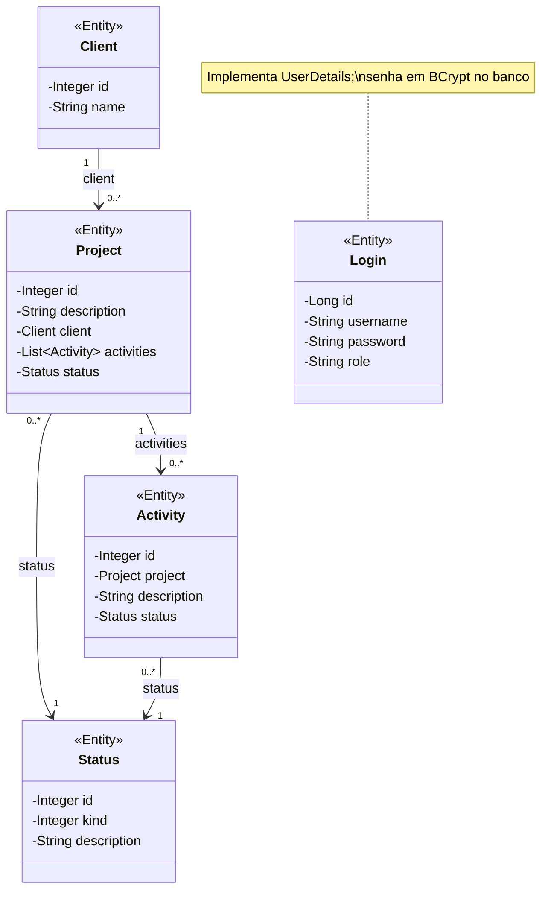
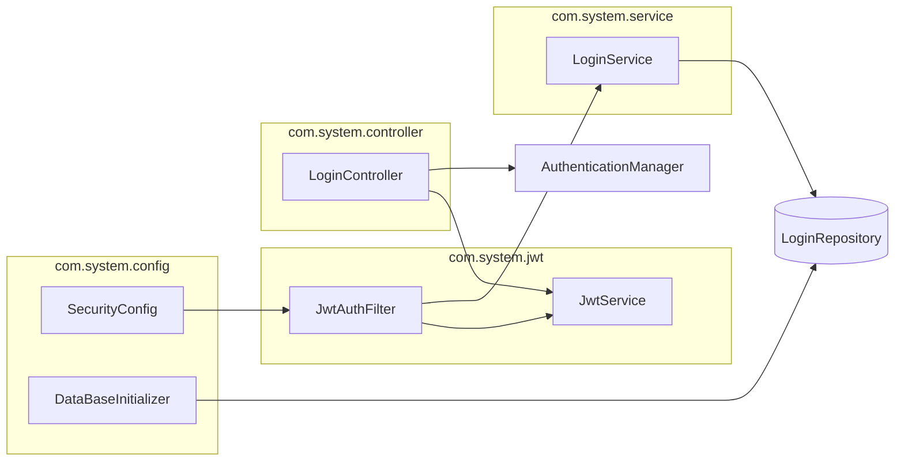
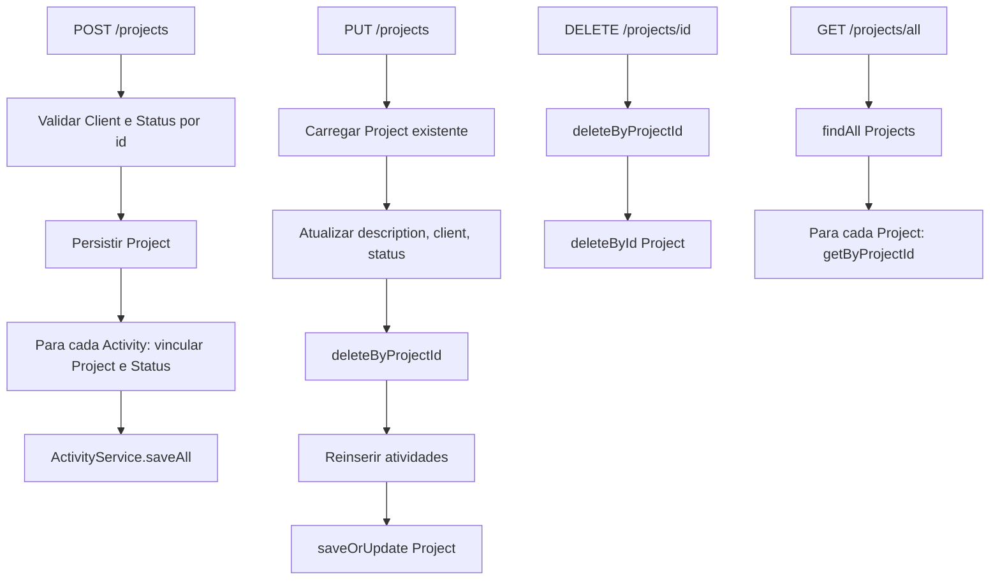

# Diagramas — Client Project System

Documentação visual da **regra de negócio** da API REST de gestão de clientes, projetos, atividades e status, incluindo **autenticação por login e JWT**.

---

### Regras de acesso

| Rota | Autenticação | Observação |
|------|--------------|------------|
| `POST /login` | Não | Retorna token JWT |
| Demais rotas (`/clients`, `/projects`, `/activities`, `/status`, etc.) | Sim (Bearer JWT) | Sessão stateless; token válido por 10 horas |

---

## Diagrama de classes (`com.system.model`)

Diagrama UML das quatro entidades JPA do pacote `com.system.model`, com atributos, associações e anotações de mapeamento presentes no código.

### Mapeamento JPA (pacote `model`)

| Classe | Atributo | Anotação | Coluna / observação |
|--------|----------|----------|---------------------|
| `Client` | `id` | `@Id`, `@GeneratedValue(IDENTITY)` | PK |
| `Client` | `name` | `@Column(length=150, nullable=false)` | |
| `Project` | `id` | `@Id`, `@GeneratedValue(IDENTITY)` | PK |
| `Project` | `description` | `@Column(length=150, nullable=false)` | |
| `Project` | `client` | `@ManyToOne`, `@JoinColumn(client_id)` | FK → `Client` |
| `Project` | `status` | `@ManyToOne`, `@JoinColumn(status_id)` | FK → `Status` |
| `Project` | `activities` | `@Transient`, `@OneToMany(mappedBy=project)` | Não persistido como coleção |
| `Activity` | `id` | `@Id`, `@GeneratedValue(IDENTITY)` | PK |
| `Activity` | `project` | `@ManyToOne(cascade=ALL)`, `@JoinColumn(project_id)` | FK → `Project` |
| `Activity` | `description` | `@Column(length=100, nullable=false)` | |
| `Activity` | `status` | `@ManyToOne(cascade=ALL)`, `@JoinColumn(status_id)` | FK → `Status` |
| `Status` | `id` | `@Id`, `@GeneratedValue(IDENTITY)` | PK |
| `Status` | `kind` | `@Column(nullable=false)` | |
| `Status` | `description` | `@Column(length=100, nullable=false)` | |
| `Login` | `id` | `@Id`, `@GeneratedValue(IDENTITY)` | PK |
| `Login` | `username` | `@Column(unique=true, nullable=false)` | Usado no login |
| `Login` | `password` | `@Column(nullable=false)` | Hash BCrypt |
| `Login` | `role` | — | Ex.: `ADMIN` → `ROLE_ADMIN` |

`Activity.project` é omitido na serialização JSON (`@JsonIgnore` no getter).

`Login` não se relaciona com Client/Project; representa o **usuário do sistema** que acessa a API.

### Componentes de segurança (fora do pacote `model`)

---

## Fluxos de negócio principais

### Ciclo de vida do projeto

### Escopo dos recursos

| Recurso   | CRUD completo via API | Autenticação | Observação |
|-----------|----------------------|--------------|------------|
| Login     | Não (apenas `POST /login`) | Público no login | Emite JWT; sem CRUD de usuários na API |
| Client    | Sim (`/clients`)     | JWT obrigatório | Atualização de nome via query param |
| Status    | Sim (`/status`)      | JWT obrigatório | Catálogo compartilhado por projetos e atividades |
| Project   | Sim (`/projects`)    | JWT obrigatório | Criação/atualização inclui lista de atividades |
| Activity  | Parcial (`GET` apenas) | JWT obrigatório | Criação, substituição e exclusão somente pelo fluxo de **Project** |

---

## Legenda

| Símbolo / termo | Significado |
|-----------------|-------------|
| `<<Entity>>` | Classe anotada com `@Entity` em `com.system.model` |
| `@Transient` | Atributo presente no modelo, sem coluna própria no banco |
| Multiplicidades | Derivadas de `@ManyToOne` / `@OneToMany` no lado proprietário da associação |

---

## Referência

Detalhes de endpoints, exemplos HTTP e configuração: [README.md](../README.md).
